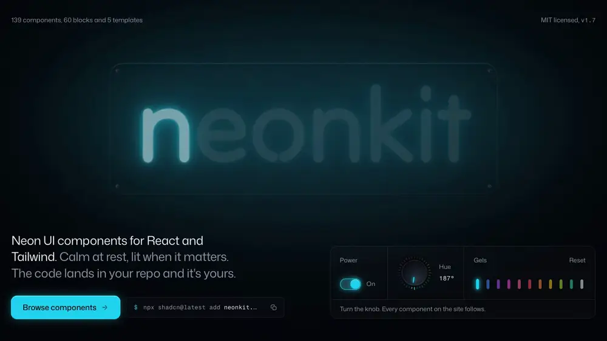

<p align="center">
  <a href="https://neonkit.heyaadi.com">
    
  </a>
</p>

<h1 align="center">NeonKit</h1>

<p align="center">
  Neon UI components for React and Tailwind. Calm at rest, lit when it matters.<br />
  139 components, 60 blocks, 5 templates and 412 icons. One CSS variable colors all of it.
</p>

<p align="center">
  <a href="https://neonkit.heyaadi.com"><b>neonkit.heyaadi.com</b></a> ·
  <a href="https://neonkit.heyaadi.com/components">Components</a> ·
  <a href="https://neonkit.heyaadi.com/blocks">Blocks</a> ·
  <a href="https://neonkit.heyaadi.com/templates">Templates</a> ·
  <a href="https://neonkit.heyaadi.com/components/icons">Icons</a> ·
  <a href="https://neonkit.heyaadi.com/theme">Theme Studio</a> ·
  <a href="https://neonkit.heyaadi.com/docs/design">Design language</a>
</p>

<p align="center">
  <a href="./LICENSE"></a>
  <a href="https://ui.shadcn.com/docs/registry"></a>
  
  
</p>

---

## Why it's different

- **Glow is light, not paint.** A lit control has a white-hot core, colored glass and a halo that spills onto the surface around it. Nothing glows at rest; light marks state: on, focused, live, or the one thing to press.
- **One variable.** Every component reads `--neon`. Pass `color="lime"` or any hex, or set it on a parent and everything inside follows. `--neon-glow` scales every halo in the library, from a flat dark UI to a bar sign.
- **Things nobody else ships.** A knob with detents, a fader, a VU meter with real ballistics, an oscilloscope with phosphor persistence, split-flap boards, seven-segment displays, a neon sign builder, a globe, lasers.
- **Its own icons.** 412 glyphs drawn as bent glass tube, with a blockout gap wherever a tube passes behind itself. Same names and props as lucide-react.
- **The code is yours.** It's a shadcn registry: one command writes the source into your project. No runtime package to update, nothing to wrap.

## Quick start

```bash
npx shadcn@latest add https://neonkit.heyaadi.com/r/switch.json
```

Or register the namespace once in `components.json` and use short names:

```json
{ "registries": { "@neonkit": "https://neonkit.heyaadi.com/r/{name}.json" } }
```

```bash
npx shadcn@latest add @neonkit/switch @neonkit/knob @neonkit/toast
```

New to shadcn? Run `npx shadcn@latest init` first. Prefer to paste? Every component page has a Manual tab with the full source.

```tsx
import { Switch } from "@/components/ui/switch"

<Switch color="magenta" defaultChecked />
```

## Color and glow

```tsx
<Button color="lime">Approve</Button>        // a palette name
<Badge color="#ff6a00">Beta</Badge>          // any hex
<section style={neonVars("violet")}>…</section> // everything inside
```

```css
:root {
  --neon-accent: 163 230 53; /* the app-wide default */
  --neon-glow: 0.6;          /* every halo at 60% */
}
```

Or tune it all visually in the [Theme Studio](https://neonkit.heyaadi.com/theme) and export `globals.css`, `lib/neon.ts` or a one-line shadcn install. The rules behind it are on [Design language](https://neonkit.heyaadi.com/docs/design).

## Blocks and templates

[Blocks](https://neonkit.heyaadi.com/blocks) are whole sections built from the components: heroes, navbars, pricing, testimonials, auth, app shells, dashboards, 404s and more. One command adds a block and every component it uses:

```bash
npx shadcn@latest add @neonkit/hero-city
```

[Templates](https://neonkit.heyaadi.com/templates) are complete Next.js sites. Each keeps its color, brand and base path in one `config.ts`:

| Template | What you get |
| --- | --- |
| `saas` | Nightshift, a deploy scheduler. A lit 2am hero, live night-run panel, install terminal, pricing with a full `/pricing` comparison, customers, FAQ and an arming-switch CTA. |
| `dashboard` | Switchback, a deploy console. Sidebar shell with ⌘K, KPIs, chart and live status board, a filterable `/projects` table and tabbed `/settings`. |
| `portfolio` | Juno Park, a design engineer. One page under a pendant lamp whose pull cord turns every light off. |
| `launch` | Low Light, a one-night conference. A split-flap board counts down, flips to live, then to the replay. |
| `docs` | Gantry, a container CLI. Sidebar nav, ⌘K search, an outline that tracks your reading, callouts and prev/next. |

```bash
npx shadcn@latest add @neonkit/saas --overwrite
```

`--overwrite` replaces the `button.tsx` that `shadcn init` wrote with NeonKit's, which accepts both `asChild` and Base UI's `render`.

## With AI tools

- [`/llms.txt`](https://neonkit.heyaadi.com/llms.txt) and [`/llms-full.txt`](https://neonkit.heyaadi.com/llms-full.txt) for any agent.
- Every component page has a markdown twin (add `.md` to the URL) and opens in v0, ChatGPT or Claude.
- With the namespace above, the [shadcn MCP server](https://neonkit.heyaadi.com/docs/ai#mcp) can search and install NeonKit for you.

## Components

- **Foundations** (1): [Icons](https://neonkit.heyaadi.com/components/icons)
- **Forms** (22): [Button](https://neonkit.heyaadi.com/components/button), [Input](https://neonkit.heyaadi.com/components/input), [Textarea](https://neonkit.heyaadi.com/components/textarea), [Select](https://neonkit.heyaadi.com/components/select), [Checkbox](https://neonkit.heyaadi.com/components/checkbox), [Radio Group](https://neonkit.heyaadi.com/components/radio-group), [Switch](https://neonkit.heyaadi.com/components/switch), [Slider](https://neonkit.heyaadi.com/components/slider), [OTP Input](https://neonkit.heyaadi.com/components/otp-input), [Toggle Group](https://neonkit.heyaadi.com/components/toggle-group), [Combobox](https://neonkit.heyaadi.com/components/combobox), [Tag Input](https://neonkit.heyaadi.com/components/tag-input), [Number Input](https://neonkit.heyaadi.com/components/number-input), [File Dropzone](https://neonkit.heyaadi.com/components/file-dropzone), [Rating](https://neonkit.heyaadi.com/components/rating), [Color Picker](https://neonkit.heyaadi.com/components/color-picker), [Calendar](https://neonkit.heyaadi.com/components/calendar), [Date Picker](https://neonkit.heyaadi.com/components/date-picker), [Time Input](https://neonkit.heyaadi.com/components/time-input), [Field](https://neonkit.heyaadi.com/components/field), [Input Group](https://neonkit.heyaadi.com/components/input-group), [Password Input](https://neonkit.heyaadi.com/components/password-input)
- **Buttons** (8): [Shimmer Button](https://neonkit.heyaadi.com/components/shimmer-button), [Pulse Button](https://neonkit.heyaadi.com/components/pulse-button), [Magnetic Button](https://neonkit.heyaadi.com/components/magnetic-button), [Power Button](https://neonkit.heyaadi.com/components/power-button), [Cyber Button](https://neonkit.heyaadi.com/components/cyber-button), [Hold Button](https://neonkit.heyaadi.com/components/hold-button), [Copy Button](https://neonkit.heyaadi.com/components/copy-button), [Button Group](https://neonkit.heyaadi.com/components/button-group)
- **Data Display** (15): [Badge](https://neonkit.heyaadi.com/components/badge), [Avatar](https://neonkit.heyaadi.com/components/avatar), [Card](https://neonkit.heyaadi.com/components/card), [Kbd](https://neonkit.heyaadi.com/components/kbd), [Tabs](https://neonkit.heyaadi.com/components/tabs), [Accordion](https://neonkit.heyaadi.com/components/accordion), [Table](https://neonkit.heyaadi.com/components/table), [Timeline](https://neonkit.heyaadi.com/components/timeline), [Glow Chart](https://neonkit.heyaadi.com/components/glow-chart), [Code Block](https://neonkit.heyaadi.com/components/code-block), [Data Table](https://neonkit.heyaadi.com/components/data-table), [Stat](https://neonkit.heyaadi.com/components/stat), [Donut Chart](https://neonkit.heyaadi.com/components/donut-chart), [Image Compare](https://neonkit.heyaadi.com/components/image-compare), [Heatmap](https://neonkit.heyaadi.com/components/heatmap)
- **Navigation** (8): [Breadcrumb](https://neonkit.heyaadi.com/components/breadcrumb), [Pagination](https://neonkit.heyaadi.com/components/pagination), [Stepper](https://neonkit.heyaadi.com/components/stepper), [Navigation Menu](https://neonkit.heyaadi.com/components/navigation-menu), [Sidebar](https://neonkit.heyaadi.com/components/sidebar), [Menubar](https://neonkit.heyaadi.com/components/menubar), [Tree View](https://neonkit.heyaadi.com/components/tree-view), [Dock](https://neonkit.heyaadi.com/components/dock)
- **Overlay** (11): [Dialog](https://neonkit.heyaadi.com/components/dialog), [Tooltip](https://neonkit.heyaadi.com/components/tooltip), [Dropdown Menu](https://neonkit.heyaadi.com/components/dropdown-menu), [Context Menu](https://neonkit.heyaadi.com/components/context-menu), [Popover](https://neonkit.heyaadi.com/components/popover), [Hover Card](https://neonkit.heyaadi.com/components/hover-card), [Command](https://neonkit.heyaadi.com/components/command), [Sheet](https://neonkit.heyaadi.com/components/sheet), [Alert Dialog](https://neonkit.heyaadi.com/components/alert-dialog), [Drawer](https://neonkit.heyaadi.com/components/drawer), [Tour](https://neonkit.heyaadi.com/components/tour)
- **Feedback** (9): [Progress](https://neonkit.heyaadi.com/components/progress), [Spinner](https://neonkit.heyaadi.com/components/spinner), [Skeleton](https://neonkit.heyaadi.com/components/skeleton), [Alert](https://neonkit.heyaadi.com/components/alert), [Toast](https://neonkit.heyaadi.com/components/toast), [Empty](https://neonkit.heyaadi.com/components/empty), [Status Light](https://neonkit.heyaadi.com/components/status-light), [Banner](https://neonkit.heyaadi.com/components/banner), [Scroll Progress](https://neonkit.heyaadi.com/components/scroll-progress)
- **Layout** (8): [Separator](https://neonkit.heyaadi.com/components/separator), [Scroll Area](https://neonkit.heyaadi.com/components/scroll-area), [Collapsible](https://neonkit.heyaadi.com/components/collapsible), [Item](https://neonkit.heyaadi.com/components/item), [Resizable](https://neonkit.heyaadi.com/components/resizable), [Carousel](https://neonkit.heyaadi.com/components/carousel), [Device Frame](https://neonkit.heyaadi.com/components/device-frame), [Aspect Ratio](https://neonkit.heyaadi.com/components/aspect-ratio)
- **AI** (11): [Chat Message](https://neonkit.heyaadi.com/components/chat-message), [Prompt Input](https://neonkit.heyaadi.com/components/prompt-input), [Conversation](https://neonkit.heyaadi.com/components/conversation), [Reasoning](https://neonkit.heyaadi.com/components/reasoning), [Tool Call](https://neonkit.heyaadi.com/components/tool-call), [Agent Plan](https://neonkit.heyaadi.com/components/agent-plan), [Sources](https://neonkit.heyaadi.com/components/sources), [Context Meter](https://neonkit.heyaadi.com/components/context-meter), [Voice Input](https://neonkit.heyaadi.com/components/voice-input), [Model Select](https://neonkit.heyaadi.com/components/model-select), [Suggestions](https://neonkit.heyaadi.com/components/suggestions)
- **Text** (10): [Neon Text](https://neonkit.heyaadi.com/components/neon-text), [Neon Sign](https://neonkit.heyaadi.com/components/neon-sign), [Glitch Text](https://neonkit.heyaadi.com/components/glitch-text), [Scramble Text](https://neonkit.heyaadi.com/components/scramble-text), [Terminal](https://neonkit.heyaadi.com/components/terminal), [Split-Flap Board](https://neonkit.heyaadi.com/components/split-flap), [Seven-Segment Display](https://neonkit.heyaadi.com/components/seven-segment), [LED Matrix](https://neonkit.heyaadi.com/components/led-matrix), [Odometer](https://neonkit.heyaadi.com/components/odometer), [Rotating Text](https://neonkit.heyaadi.com/components/rotating-text)
- **Instruments** (11): [Knob](https://neonkit.heyaadi.com/components/knob), [Fader](https://neonkit.heyaadi.com/components/fader), [Hardware Switch](https://neonkit.heyaadi.com/components/hardware-switch), [Gauge](https://neonkit.heyaadi.com/components/gauge), [Meter](https://neonkit.heyaadi.com/components/meter), [Equalizer](https://neonkit.heyaadi.com/components/equalizer), [Oscilloscope](https://neonkit.heyaadi.com/components/oscilloscope), [Radar](https://neonkit.heyaadi.com/components/radar), [Heartbeat](https://neonkit.heyaadi.com/components/heartbeat), [Countdown](https://neonkit.heyaadi.com/components/countdown), [Neon Clock](https://neonkit.heyaadi.com/components/neon-clock)
- **Effects** (11): [Border Beam](https://neonkit.heyaadi.com/components/border-beam), [Spotlight Card](https://neonkit.heyaadi.com/components/spotlight-card), [Hologram Card](https://neonkit.heyaadi.com/components/hologram-card), [Neon Frame](https://neonkit.heyaadi.com/components/neon-frame), [Tube Divider](https://neonkit.heyaadi.com/components/tube-divider), [CRT Overlay](https://neonkit.heyaadi.com/components/crt-overlay), [Cursor Glow](https://neonkit.heyaadi.com/components/cursor-glow), [Marquee](https://neonkit.heyaadi.com/components/marquee), [Neon Icon](https://neonkit.heyaadi.com/components/neon-icon), [Signal Beam](https://neonkit.heyaadi.com/components/signal-beam), [Sparks](https://neonkit.heyaadi.com/components/sparks)
- **Backgrounds** (14): [Retro Grid](https://neonkit.heyaadi.com/components/retro-grid), [Aurora](https://neonkit.heyaadi.com/components/aurora), [Starfield](https://neonkit.heyaadi.com/components/starfield), [Light Rays](https://neonkit.heyaadi.com/components/light-rays), [Cityscape](https://neonkit.heyaadi.com/components/cityscape), [Rain on Glass](https://neonkit.heyaadi.com/components/rain-glass), [Particles](https://neonkit.heyaadi.com/components/particles), [Globe](https://neonkit.heyaadi.com/components/globe), [Dot Grid](https://neonkit.heyaadi.com/components/dot-grid), [Circuit](https://neonkit.heyaadi.com/components/circuit), [Lasers](https://neonkit.heyaadi.com/components/lasers), [Tunnel](https://neonkit.heyaadi.com/components/tunnel), [Sunset](https://neonkit.heyaadi.com/components/sunset), [Haze](https://neonkit.heyaadi.com/components/haze)

All of them work on React 18 and 19 and Tailwind 3.4 and 4, use native elements where they exist, are fully keyboard accessible, and give a still, complete composition under reduced motion.

## Develop

```bash
npm install
npm run dev
```

| Command | What it checks |
| --- | --- |
| `npm run build` | Regenerates the registry in `public/r/` and fails if a component imports something its entry doesn't declare. |
| `npm test` | Behaviour, keyboard and ARIA tests, registry integrity, Tailwind 3/4-safe classes and size budgets. |
| `npm run a11y` | axe on every component, block and template page. |
| `npm run install-test` | Installs a set of components, a block and a template into a fresh Next.js + shadcn app and builds it. |

```
src/components/ui/        the components (what people install)
src/components/blocks/    the blocks
src/components/templates/ the templates
src/lib/neon.ts           palette and neonVars()
src/registry/             metadata, docs and live examples
app/                      the site
```

See [CONTRIBUTING.md](./CONTRIBUTING.md) for the component rules. Missing something? [Request it](https://neonkit.heyaadi.com/request).

## Support

NeonKit is free and built by one person. If it saves you time, [sponsor on GitHub](https://github.com/sponsors/AadiXC0DE), [buy me a coffee](https://www.buymeacoffee.com/AadiChowdhury7), or star the repo so other people find it.

Built by [Aaditya Chowdhury](https://heyaadi.com) ([@AadiChowdhury7](https://x.com/AadiChowdhury7)).

## License

MIT. See [LICENSE](./LICENSE).
